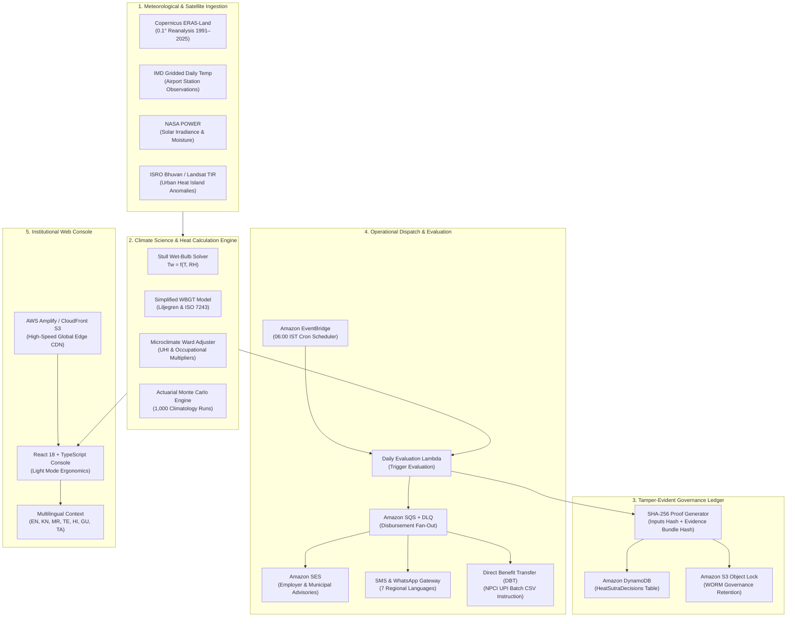
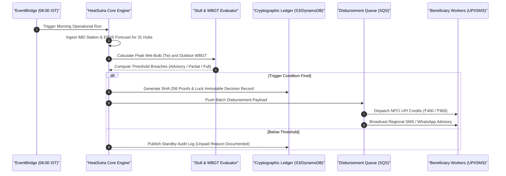
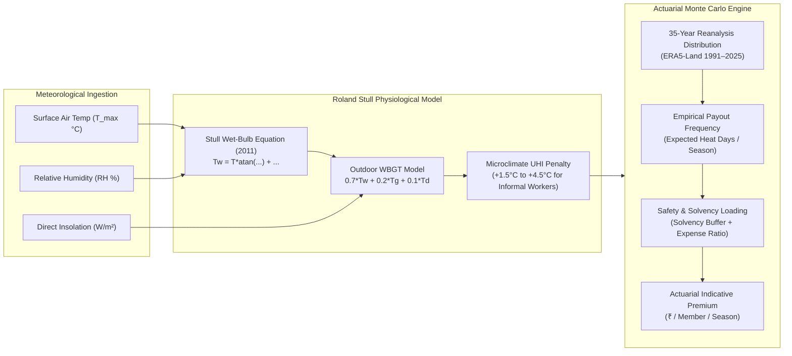
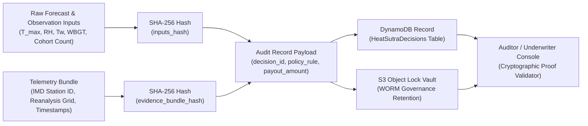
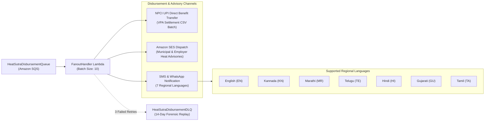
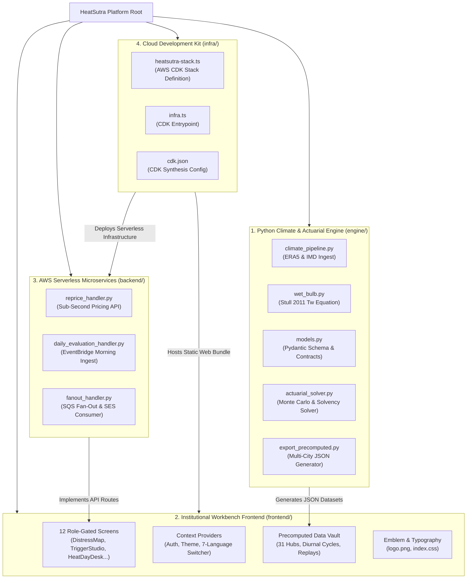

# HeatSutra
### Open Parametric Heat-Cover Workbench for Informal Outdoor Workers

HeatSutra is an open parametric heat-cover workbench engineered for organisations running income-protection programmes for informal outdoor workers across India—including trade unions (such as SEWA), cooperatives, welfare boards, gig platforms, and municipal heat-action cells.

A programme officer using HeatSutra can:
1. **Design a heat payout trigger** across dry-bulb, wet-bulb (Stull formula), or hybrid families with multi-tier thresholds (Advisory, Partial, Full).
2. **Audit data trust & basis risk** by comparing satellite reanalysis against official surface airport stations across 31 Indian cities (exposing station microclimate blind spots and urban heat islands).
3. **Calibrate triggers to per-member budgets**, computing the actuarial indicative premium, member self-financed share, and required donor/CSR subsidy gap.
4. **Replay historical summer seasons (2023, 2024, 2025)** day-by-day against published field pilot rules (reproducing documented zero-payout failures and explaining data differences).
5. **Run daily morning operational evaluations**, producing downloadable UPI disbursement CSVs, employer advisories (via Amazon SES), municipal Heat Action Plan (HAP) checklists, and plain-language worker notifications in 7 regional languages (English, Kannada, Marathi, Telugu, Hindi, Gujarati, Tamil).
6. **Maintain an immutable decision record** with SHA-256 cryptographic hashes stored under S3 Object Lock governance mode and DynamoDB.

---

## The Reality Behind the Peril

- **Trigger Failure in Field Pilots**: In the 2023 Ahmedabad pilot, payout thresholds were set at 43.6°C (partial) and 44.1°C (full) across two consecutive days. Despite record-breaking heat stress, the consecutive condition failed to fire on single extreme days, resulting in **zero payouts** to vulnerable workers. In 2025, a separate Gujarat scheme repeated the failure, forcing the threshold to be lowered to 42.74°C for 2026.
- **The Humidity Blind Spot**: Dry-bulb thermometers register air temperature alone. When relative humidity exceeds 60%, air at 36°C produces a wet-bulb temperature exceeding 30.5°C—the lethal threshold where human sweat evaporation fails. Informal workers in coastal and riverine hubs (Kolkata, Chennai, Mumbai, Visakhapatnam) suffer heat collapse on days that never trigger a dry-bulb threshold.
- **Microclimate & Urban Heat Island (UHI) Disparity**: Official airport weather stations sit over manicured grass runways. Informal workers labor over asphalt roads, under uninsulated corrugated tin roofs, or beside industrial ovens where effective temperatures are 3°C to 6°C hotter. HeatSutra models these microclimate penalties to guarantee relief triggers fire when workers need them most.

---

## System Architecture

HeatSutra is architected as a modular, event-driven, serverless platform combining real-time meteorological ingestion, physiological heat-stress models, actuarial solvency stress-testing, and automated disbursement instruction generation.



---

## System Design & Data Flow

### 1. Parametric Trigger Pipeline

The daily execution lifecycle evaluates 31 Indian territory hubs at 06:00 IST before informal workers start their morning shifts.



---

### 2. Physiological & Actuarial Calculation Flow



---

### 3. Multi-Tier Parametric Policy Decision Tree

```mermaid
flowchart TB
    Start["Morning Forecast Assessment (06:00 IST)"]
    
    subgraph PolicyBranches["Configured Policy Evaluation"]
        P1["SEWA Pilot Benchmark<br/>(Dry-Bulb Consecutive)"]
        P2["Gujarat 2026 Model<br/>(Dry-Bulb Single-Day)"]
        P3["Stull Physiological<br/>(Wet-Bulb Tw)"]
        P4["HeatSutra Hybrid Shield<br/>(Dual Metric T_max OR Tw)"]
    end

    Start --> P1
    Start --> P2
    Start --> P3
    Start --> P4

    P1 -->|T at least 44.1°C (2 Days)| P1Full["Full Payout (₹900)"]
    P1 -->|T at least 43.6°C (2 Days)| P1Part["Partial Payout (₹400)"]
    P1 -->|Fails Consecutive Rule| Standby["Standby State (₹0)<br/>Audit Trail Logged"]

    P2 -->|T at least 42.74°C (1 Day)| P2Full["Full Payout (₹900)"]
    P2 -->|Below 42.74°C| Standby

    P3 -->|Tw at least 30.8°C (Lethal)| P3Full["Full Payout (₹900)"]
    P3 -->|Tw at least 29.8°C (Extreme)| P3Part["Partial Payout (₹400)"]
    P3 -->|Below 29.8°C| Standby

    P4 -->|T at least 44.1°C OR Tw at least 31.0°C| P4Full["Full Payout (₹900)<br/>Zero Humidity Blind Spot"]
    P4 -->|T at least 43.2°C OR Tw at least 30.2°C| P4Part["Partial Payout (₹400)"]
    P4 -->|T at least 42.0°C (Pre-Alert)| P4Adv["Advisory Alert Only<br/>HAP Municipal Action"]
    P4 -->|Below All Tiers| Standby
```

HeatSutra supports 4 primary trigger families designed to prevent the catastrophic pilot failures of 2023–2025:

| Trigger Family | Primary Peril Metric | Threshold Configuration | Consecutive Days | Rationale & Protection Target |
| :--- | :--- | :--- | :---: | :--- |
| **SEWA 2-Day Pilot Benchmark** | Surface Dry-Bulb ($T_{\text{max}}$) | 43.6°C (Partial), 44.1°C (Full) | 2 | Published field benchmark. Replays demonstrate frequent zero-payout failures. |
| **Revised Gujarat 2026** | Surface Dry-Bulb ($T_{\text{max}}$) | 42.74°C (Full) | 1 | Single-day threshold calibrated to prevent consecutive-day lockout. |
| **Stull Physiological Wet-Bulb** | Wet-Bulb Temperature ($T_w$) | 29.8°C (Partial), 30.8°C (Full) | 1 | Directly measures evaporative cooling failure and lethal physiological heat collapse. |
| **HeatSutra Hybrid Shield** | Dual Metric ($T_{\text{max}}$ OR $T_w$) | $T_{\text{max}} \ge 43.2^\circ\text{C}$ OR $T_w \ge 30.2^\circ\text{C}$ | 2 or 1 spike | **Zero Blind Spot Guarantee**: Catches dry inland scorchers AND coastal humid heatwaves. |

---

### 4. Cryptographic Tamper-Evidence & Audit Pipeline

To satisfy insurance underwriters, international climate funds, and municipal auditors, every single decision (whether paid or unpaid) produces an immutable cryptographic audit record.



---

### 5. Multi-Channel Disbursement & Multilingual Outreach Architecture



---

## Repository Structure & Modular Hierarchy



### Directory Tree Overview

```
HeatSutra/
├── engine/                       # Python Climate Science & Actuarial Engine
│   ├── climate_pipeline.py       # Multi-city reanalysis ingestion, IMD station mapping
│   ├── wet_bulb.py               # Roland Stull (2011) empirical wet-bulb equation
│   ├── models.py                 # Strictly typed Pydantic models (triggers, policies, audits)
│   ├── actuarial_solver.py       # Pure premium, frequency/severity & loading solver
│   └── export_precomputed.py     # Deterministic data generation for all 31 Indian cities
├── frontend/                     # React 18 + TypeScript Web Application
│   ├── public/
│   │   ├── data/                 # 8 Precomputed JSON datasets (cities, diurnal, replays)
│   │   ├── logo.png              # High-resolution HeatSutra brand emblem
│   │   ├── favicon.png           # Tab icon
│   │   └── index.html            # Main HTML document
│   ├── src/
│   │   ├── components/
│   │   │   ├── layout/TopBar.tsx # Light console topbar, logo, language switcher, static role badge
│   │   │   └── screens/          # 12 Operational and Science Workbench screens
│   │   │       ├── TriggerStudio.tsx         # Multi-metric trigger designer & budget solver
│   │   │       ├── DistressMap.tsx           # Interactive 31-city thermal stress GIS map
│   │   │       ├── HeatDayDesk.tsx           # Daily morning operations & UPI CSV export
│   │   │       ├── SeasonReplay.tsx          # Historical 2023–2025 season replay engine
│   │   │       ├── DataTrust.tsx             # IMD vs ERA5 basis risk audit leaderboard
│   │   │       ├── DatasetCatalog.tsx        # Registry of freely available open datasets
│   │   │       ├── UrbanMicroclimateAudit.tsx# Ward-level UHI heat stress simulator
│   │   │       ├── CohortRegistry.tsx        # 1.02M worker trade segmentation & UPI mappings
│   │   │       ├── ActuarialStressStudio.tsx # Monte Carlo fund solvency stress tests
│   │   │       ├── DisbursementSandbox.tsx   # Simulated NPCI UPI DBT settlement stream
│   │   │       ├── DecisionRecord.tsx        # Tamper-evident reviewer ledger & hash inspector
│   │   │       ├── PolicyContractSchedule.tsx# Parametric policy contract schedule
│   │   │       └── LoginPage.tsx             # Strict institutional login landing page
│   │   ├── context/
│   │   │   ├── AuthContext.tsx   # Strict role-based authentication (Officer vs Reviewer)
│   │   │   ├── ThemeContext.tsx  # Locked light console theme provider
│   │   │   └── LanguageContext.tsx # 7 Regional languages (EN, KN, MR, TE, HI, GU, TA)
│   │   └── styles/index.css      # Design system tokens, high-contrast light console typography
├── backend/                      # Production AWS Lambda Microservices
│   └── handlers/
│       ├── reprice_handler.py    # Sub-second trigger re-pricing API handler
│       ├── daily_evaluation_handler.py # EventBridge scheduled morning trigger evaluator
│       └── fanout_handler.py     # SQS queue consumer for SES and alert broadcast
├── infra/                        # AWS Cloud Development Kit (CDK) Infrastructure
│   ├── lib/
│   │   └── heatsutra-stack.ts    # CDK Stack definition for full AWS deployment
│   ├── bin/infra.ts              # CDK entry point
│   └── cdk.json                  # CDK configuration
├── aws-architecture.md           # Exhaustive AWS Cloud Architecture Deep Dive
├── amplify.yml                   # AWS Amplify hosting build specification
└── README.md                     # Project documentation
```

---

## 31 Supported Indian Hubs

HeatSutra covers informal worker cohorts across 31 major meteorological hubs in India:

| Region | Cities / Hubs Included |
| :--- | :--- |
| **North** | Delhi NCR, Chandigarh, Ludhiana, Agra, Kanpur, Kota, Lucknow, Jaipur |
| **West & Central** | Ahmedabad, Vadodara, Surat, Rajkot, Bhopal, Indore, Nagpur, Pune, Nashik, Sholapur |
| **East & North-East**| Kolkata, Ranchi, Raipur, Patna, Guwahati, Bhubaneswar |
| **South** | Bengaluru, Hyderabad, Chennai, Visakhapatnam, Coimbatore, Madurai, Kozhikode |

---

## Quickstart & Local Setup

### 1. Prerequisites
- Node.js 18+ and `npm`
- Python 3.11+

### 2. Run the Frontend Locally
```bash
cd frontend
npm install
npm run dev
```
Open [http://localhost:3000](http://localhost:3000) in your browser.

### 3. Log In with Authorised Credentials
- **Programme Officer**: `ramilaben@sewa.org` / `officer2026`
- **Auditor & Actuary**: `v.sengupta@climaterisk.org` / `audit2026`

### 4. Regenerate Precomputed Climate Data (Optional)
```bash
python -m venv .venv
source .venv/bin/activate  # On Windows: .venv\Scripts\activate
pip install -r engine/requirements.txt
python -m engine.export_precomputed
```

---

## Build & Deployment

```bash
# Build production bundle
cd frontend
npm run build

# Synthesize AWS CDK CloudFormation Stack
cd ../infra
npm install
npx cdk synth
```

For complete cloud infrastructure details, see [AWS Architecture Deep Dive](aws-architecture.md).

---

## AI Collaboration & Attribution
In accordance with hackathon submission guidelines, the following AI tools supported the engineering of HeatSutra:
- **Google DeepMind Antigravity**: System architecture, mathematical formulation of Roland Stull's equation, CDK infrastructure design, and multilingual translation contexts.
