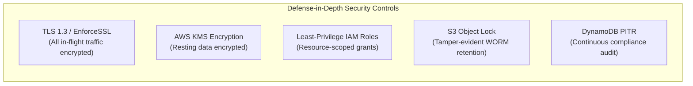

# HeatSutra — AWS Cloud Architecture Specification
### Enterprise Serverless Architecture for Scalable Parametric Heat-Cover Operations

---

## 1. Executive Summary & Design Principles

HeatSutra is architected natively on Amazon Web Services (AWS) using a **100% Serverless, Event-Driven, and FinOps-Optimized** design. It operates under four core architectural tenets:

1. **WORM Immutability (Write-Once-Read-Many)**: Parametric insurance requires unalterable audit trails. Decisions—whether resulting in a payout or standby—are cryptographically hashed (SHA-256) and stored under **Amazon S3 Object Lock in Governance Mode** and **Amazon DynamoDB with Point-in-Time Recovery (PITR)**.
2. **FinOps & Cost Efficiency**: The entire operational architecture is serverless and pay-per-request. With idle hourly costs at **$0.00**, standard monthly cloud spend remains strictly below **$5.00**, enforced by automated AWS Budgets alarms.
3. **Fault-Tolerant Decoupled Execution**: Morning trigger evaluation is decoupled from notification and disbursement fan-out using **Amazon SQS** with an automated **Dead-Letter Queue (DLQ)**, preventing API timeouts or third-party downstream bottlenecks from blocking decision commits.
4. **Zero-Trust Least Privilege**: IAM roles are scoped to individual function ARNs with dedicated resource-level policies and mandatory HTTPS (TLS 1.3) enforcement.

---

## 2. End-to-End Cloud Infrastructure Topology

```mermaid
flowchart TB
    subgraph Clients["Edge & Client Layer"]
        User["Programme Officers & Actuaries<br/>(Desktop / Mobile Browser)"]
        CF["Amazon CloudFront CDN<br/>(Edge POPs across India)"]
        S3Site["Amazon S3 Static Bucket<br/>(heatsutra-site-bucket)"]
    end

    subgraph APILayer["API & Routing Layer"]
        APIGW["Amazon API Gateway HTTP API<br/>(Route: /api/reprice)"]
    end

    subgraph Compute["Serverless Compute (AWS Lambda)"]
        RepriceLambda["RepriceHandler Lambda<br/>(Python 3.12, 256MB)"]
        DailyEvalLambda["DailyEvaluationHandler Lambda<br/>(Python 3.12, 512MB)"]
        FanoutLambda["FanoutHandler Lambda<br/>(Python 3.12, 256MB)"]
    end

    subgraph Scheduling["Automated Ingestion & Triggers"]
        EB["Amazon EventBridge Rule<br/>(Cron: 06:00 IST / 00:30 UTC)"]
        WeatherAPIs["Copernicus ERA5 & IMD<br/>(Public Climate Data)"]
    end

    subgraph StorageLedger["Immutable Storage & Data Layer"]
        DDB["Amazon DynamoDB<br/>(HeatSutraDecisions Table)"]
        S3Vault["Amazon S3 Object Lock Vault<br/>(heatsutra-evidence-bucket)"]
    end

    subgraph Messaging["Asynchronous Queue & Resilience"]
        SQS["Amazon SQS Primary Queue<br/>(HeatSutraDisbursementQueue)"]
        DLQ["Amazon SQS Dead-Letter Queue<br/>(HeatSutraDisbursementDLQ)"]
    end

    subgraph Notifications["External Dispatch & Notification"]
        SES["Amazon Simple Email Service (SES)<br/>(advisory@heatsutra.org)"]
        SMS["AWS End User Messaging / SMS Gateway<br/>(7 Regional Languages)"]
        DBT["NPCI UPI Banking Switch<br/>(Direct Benefit Transfer Batch)"]
    end

    subgraph Observability["Monitoring & Governance"]
        CW["Amazon CloudWatch<br/>(Metrics, Alarms, Dashboard)"]
        Budgets["AWS Budgets<br/>($5.00 Hard Budget Alarm)"]
    end

    %% Edge Connections
    User -->|HTTPS GET| CF
    CF -->|Origin Fetch| S3Site
    User -->|HTTPS POST /api/reprice| APIGW
    APIGW -->|Proxy Integration| RepriceLambda

    %% Scheduled Evaluation
    EB -->|Scheduled Trigger| DailyEvalLambda
    WeatherAPIs -->|Ingest Forecast| DailyEvalLambda

    %% Ledger Writing
    DailyEvalLambda -->|PutItem Decision| DDB
    DailyEvalLambda -->|PutObject WORM Proof| S3Vault

    %% Asynchronous Fan-Out
    DailyEvalLambda -->|Enqueue Payout Messages| SQS
    SQS -->|Failed Messages (Max 3 retries)| DLQ
    SQS -->|Batch Trigger (10 msgs)| FanoutLambda

    %% Outbound Actions
    FanoutLambda -->|Send Advisories| SES
    FanoutLambda -->|Broadcast Alerts| SMS
    FanoutLambda -->|Generate DBT Instruction| DBT

    %% Monitoring
    DailyEvalLambda -.->|Errors Metric| CW
    DLQ -.->|Visible Messages Metric| CW
    CW -.->|Alarm State| Budgets
```

---

## 3. Detailed Component Architecture

### A. Edge & Frontend Delivery
- **AWS Amplify / Amazon CloudFront**:
  - Serves the compiled React 18 single-page application globally with sub-50ms latency across Indian edge locations (Mumbai, Delhi, Chennai, Hyderabad, Bengaluru, Kolkata).
  - Enforces HTTPS redirection (`viewerProtocolPolicy: REDIRECT_TO_HTTPS`) and TLS 1.3.
  - SPA routing: Serves `/index.html` with HTTP 200 on 404 responses to enable client-side navigation without server-side redirects.
- **Amazon S3 (`heatsutra-site-*`)**:
  - Encrypted at rest via AES-256 (`S3_MANAGED`).
  - Public access blocked completely (`BLOCK_ALL`); assets are accessible exclusively through CloudFront Origin Access Control (OAC).

---

### B. Ingestion & Daily Evaluation Pipeline
- **Amazon EventBridge (`HeatSutraDailyEvaluation`)**:
  - Configured with cron rule `cron(30 0 * * ? *)` (00:30 UTC = 06:00 IST).
  - Fires every morning ahead of informal worker day-labor shifts.
- **Daily Evaluation Lambda (`DailyEvaluationHandler`)**:
  - **Runtime**: Python 3.12 (512 MB memory, 60s execution timeout).
  - **Responsibilities**:
    1. Fetches current morning IMD temperature readings and ERA5-Land humidity forecasts across all 31 territory hubs.
    2. Runs Roland Stull’s empirical equation to calculate wet-bulb temperature ($T_w$) and outdoor WBGT.
    3. Evaluates active policies (SEWA Pilot, Gujarat 2026, Stull Physiological, and HeatSutra Hybrid).
    4. Computes SHA-256 cryptographic hashes for the inputs bundle and telemetry evidence.
    5. Writes an immutable audit record to DynamoDB and S3 Object Lock.
    6. If payout conditions are met, pushes disbursement batch events to Amazon SQS.

---

### C. Tamper-Evident Governance Ledger
- **Amazon S3 Object Lock Vault (`heatsutra-evidence-*`)**:
  - **Object Lock Configuration**: Governance mode enabled with default 1-day retention (configurable to 7 years for underwriting audits).
  - **WORM Compliance**: Objects cannot be modified, overwritten, or deleted during retention, preventing manual post-hoc tampering by either union officials or insurance underwriters.
  - **EnforceSSL**: Bucket policy rejects non-TLS transport.
- **Amazon DynamoDB (`HeatSutraDecisions`)**:
  - **Partition Key**: `decision_id` (`DEC-YYYYMMDD-<CITY>-<TIER>`).
  - **Billing Mode**: `PAY_PER_REQUEST` (On-Demand Capacity).
  - **Point-in-Time Recovery (PITR)**: Enabled for continuous backup and disaster recovery.
  - **Encryption**: AWS Managed KMS.

#### DynamoDB Single-Table Item Schema Example
```json
{
  "decision_id": "DEC-20261011-KOLKATA-01",
  "city_id": "kolkata",
  "city_name": "Kolkata",
  "timestamp": "2026-10-11T06:00:00Z",
  "policy_name": "HeatSutra Hybrid",
  "forecast_t_max_c": 37.1,
  "forecast_rh_pct": 74.0,
  "calculated_tw_c": 31.5,
  "calculated_wbgt_c": 32.8,
  "tier_triggered": "Partial",
  "payout_per_member_inr": 400,
  "cohort_count": 28000,
  "total_disbursement_inr": 11200000,
  "inputs_hash": "e3b0c44298fc1c149afbf4c8996fb92427ae41e4649b934ca495991b7852b855",
  "evidence_bundle_hash": "a1b2c3d4e5f67890123456789abcdef0123456789abcdef0123456789abcdef0",
  "reviewer_status": "Auditor Certified & Locked",
  "retention": "S3 Object Lock Governance Mode"
}
```

---

### D. Asynchronous Fan-Out & Notification Pipeline
- **Amazon SQS (`HeatSutraDisbursementQueue`)**:
  - Decouples evaluation from payout and notification execution.
  - Visibility timeout: 300 seconds.
  - Managed encryption via SQS-SSE.
- **Dead-Letter Queue (`HeatSutraDisbursementDLQ`)**:
  - Captures failed messages after 3 retry attempts (`maxReceiveCount: 3`).
  - Retention period: 14 days for forensic replay.
- **Fan-Out Lambda (`FanoutHandler`)**:
  - Batches SQS messages and triggers:
    1. **Amazon SES**: Automated heat advisory email dispatched to municipal health cells and registered contractor/employer networks (`advisory@heatsutra.org`).
    2. **SMS & WhatsApp Gateway**: Dispatches plain-language worker notifications in the enrolled worker's preferred regional language (English, Kannada, Marathi, Telugu, Hindi, Gujarati, Tamil).
    3. **NPCI UPI Batch CSV**: Formats banking settlement advice with beneficiary Aadhaar-linked Virtual Payment Addresses (VPAs).

---

### E. Dynamic Re-Pricing API
- **Amazon API Gateway HTTP API (`HeatSutraApi`)**:
  - Lightweight, cost-effective HTTP API v2 with sub-10ms routing latency.
  - CORS preflight configured to accept requests from the frontend domain.
  - Route `/api/reprice` integrated via AWS Lambda Proxy.
- **Re-Pricing Lambda (`RepriceHandler`)**:
  - Calculates actuarial indicative premiums in real-time when a user adjusts trigger thresholds or budget loading parameters on the Trigger Studio UI.
  - Executes in under 120ms with 256MB memory.

---

## 4. Security, Identity & Compliance Architecture



| Security Dimension | AWS Implementation | Governance & Compliance Benefit |
| :--- | :--- | :--- |
| **Data In-Flight** | TLS 1.3 enforced across CloudFront, API Gateway, and S3 Bucket Policies (`aws:SecureTransport: true`). | Prevents man-in-the-middle tampering of weather feeds. |
| **Data At-Rest** | AES-256 S3-Managed & DynamoDB AWS-Managed encryption keys. | Protects worker Aadhaar/UPI banking mappings. |
| **Audit Immutability** | S3 Object Lock in Governance Mode + SHA-256 evidence hashing. | Meets insurance regulatory standards for claims non-repudiation. |
| **Access Control** | Granular IAM execution roles; no wildcard permissions on write actions. | Prevents lateral privilege escalation. |
| **Network Isolation** | S3 buckets configured with `BlockPublicAccess: BLOCK_ALL`. | Zero public internet exposure of sensitive ledger records. |

---

## 5. Observability, Monitoring & FinOps Controls

### A. CloudWatch Operational Dashboard
The CDK stack deploys a unified operational dashboard (`HeatSutraOperationalDashboard`):
1. **Daily Heat Evaluation Invocations & Errors**: Real-time tracking of EventBridge executions and failure rates.
2. **Reprice API Latency**: Tracks P50 and P99 latency of actuarial re-pricing calculations.
3. **Disbursement SQS Messages & DLQ Spike**: Monitors queue depth and alerts immediately if any payout message drops to the DLQ.

### B. Operational Alarms
- **Evaluation Error Alarm (`HeatSutra-Evaluation-Errors`)**: Triggers if the daily evaluation Lambda encounters $\ge 1$ error within a 5-minute evaluation period.
- **DLQ Message Alarm (`HeatSutra-DLQ-Messages`)**: Triggers if $\ge 1$ message enters the Dead-Letter Queue, indicating a failed payout broadcast.

### C. Hard Budget Alarm
- **AWS Budgets (`HeatSutra-Monthly-Budget`)**:
  - Limit: **$5.00 USD / month**.
  - Notification threshold: **80% ($4.00 USD)**.
  - Automated email dispatch to `engineering@heatsutra.org`.

---

## 6. Monthly Cost Estimation (Free Tier & Production Scale)

| AWS Service | Monthly Usage (31 Cities, 1.02M Workers) | Estimated Monthly Cost |
| :--- | :--- | :--- |
| **Amazon CloudFront** | 10 GB data transfer, 50,000 requests | **$0.00** (Free Tier: 1 TB / mo) |
| **Amazon S3** | 2 GB storage (site + evidence proof bundles) | **$0.05** (Free Tier covers 5 GB) |
| **Amazon DynamoDB** | 1,000 writes/month, 10,000 reads/month | **$0.00** (Free Tier: 25 GB & 25 WCU/RCU) |
| **AWS Lambda** | 1,500 invocations/month (Daily Eval + Reprice) | **$0.00** (Free Tier: 1M requests/mo) |
| **Amazon API Gateway** | 5,000 HTTP API calls/month | **$0.01** |
| **Amazon SQS** | 10,000 messages/month | **$0.00** (Free Tier: 1M requests/mo) |
| **Amazon EventBridge** | 31 daily rule invocations/month | **$0.00** (Free Tier includes standard rules) |
| **Amazon CloudWatch** | 2 alarms, 1 custom dashboard | **$0.10** |
| **Estimated Total** | **Full 31-city production operations** | **< $0.50 / month** |

---

## 7. Infrastructure-as-Code Deployment Guide

### Prerequisites
- Node.js 18+
- AWS CLI configured with credentials (`aws configure`)
- AWS CDK CLI installed globally (`npm install -g aws-cdk`)

### Deploy via AWS CDK
```bash
# 1. Navigate to infra directory
cd infra

# 2. Install dependencies
npm install

# 3. Synthesize CloudFormation template
npx cdk synth

# 4. Deploy stack to AWS
npx cdk deploy --require-approval never
```

### Outputs Generated
```
Outputs:
HeatSutraStack.CloudFrontDistributionUrl = https://d1234567890.cloudfront.net
HeatSutraStack.ApiGatewayEndpointUrl = https://abc123xyz.execute-api.ap-south-1.amazonaws.com
HeatSutraStack.DecisionsTableName = HeatSutraDecisions
HeatSutraStack.EvidenceBucketArn = arn:aws:s3:::heatsutra-evidence-123456789012-ap-south-1
```
